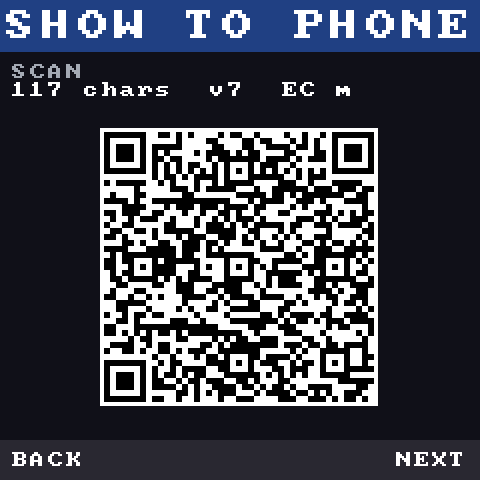
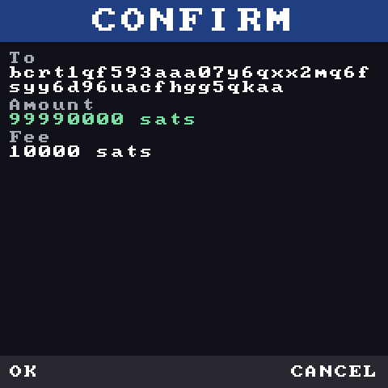
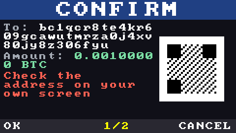
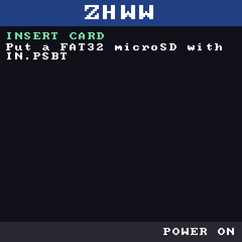
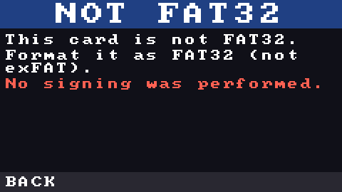
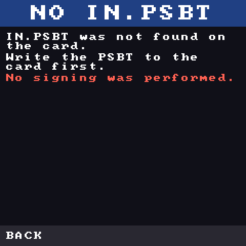
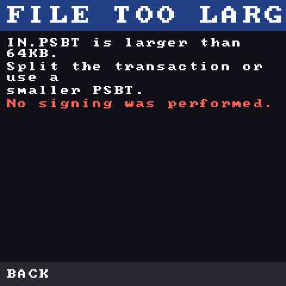
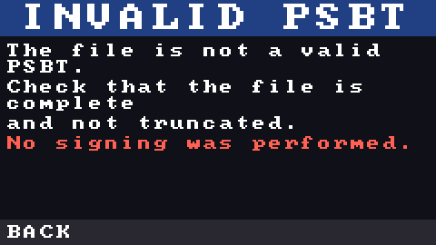
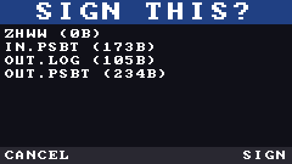
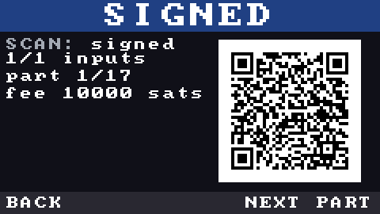

# 08. Port plan for the RP2350-PiZero

- **Target**: Waveshare RP2350-PiZero
- **Last updated**: 2026-10-14
- **Position**: **the standard build's board** (with the Adafruit Mini PiTFT and the ArduCam UC-805 camera; [03-hardware-bom.md](03-hardware-bom.md)). The preparation that does not need hardware is already done with [pico_smoke.zig](../firmware/pico_smoke.zig) and `zig build pico`

---

## Production security prerequisites

The hardware-free [RP2350 security architecture](11-rp2350-security.md) now defines an
**A4-only production candidate**, signed boot, TrustZone isolation, debug/unused boot-interface
lockdown, glitch detection and stateless Secure-SRAM secrets. Board branding does not establish
silicon stepping. Verify the actual chip before production provisioning. The policy and approval
prototypes pass host tests, but no OTP configuration, Secure/Non-secure image or HAL is implemented.
Development UF2 drag-and-drop must not be confused with the planned locked production update path.

## 1. Why this board

It achieves both "no wireless" and "no soldering" while avoiding the stock shortage of the Pi Zero 1.3 and the soldering of a pin header.

**RP2350-PiZero specifications** (sources: [Waveshare wiki](https://www.waveshare.com/wiki/RP2350-PiZero), [CNX Software's introduction](https://www.cnx-software.com/2025/07/08/rp2350-pizero-rp2350-board-with-raspberry-pi-zero-form-factor-mini-hdmi-16mb-flash/)):

| Item | Content |
|---|---|
| MCU | RP2350B (2× Cortex-M33 or 2× RISC-V Hazard3, up to 150MHz, 520KB SRAM) |
| Flash | 16MB (with pads for PSRAM) |
| Storage | **microSD (TF) slot** |
| GPIO | **40-pin (Raspberry Pi compatible)**. 28 GPIO, 2× SPI, 2× I2C, 2× UART, 16× PWM, 12× PIO |
| Power | USB Type-C (power and flashing) + **LiPo charging connector** |
| Other | USB Type-C (PIO-USB), DVI output, BOOT/RUN buttons, 65×30mm (same size as the Pi Zero) |
| Price | $9.99 (direct from Waveshare). In Japan, [スイッチサイエンス (Switch Science)](https://www.switch-science.com/products/10733) and others |
| Flashing | Drag and drop a UF2 file (BOOT button) |

**How it fits this project**:

- **No onboard wireless chip** — removes the onboard radio interface, not every communication/tampering risk. USB, media, optical transport and firmware still need a threat model.
- **Pi Zero size and a Pi-style 40-pin header** — the Mini PiTFT plugs onto pins 1–24 and the camera takes four of pins 25–40. **Several header pins carry different GPIO numbers from a Raspberry Pi's** (the table is in [03-hardware-bom.md](03-hardware-bom.md) §3)
- **A microSD slot exists but is not used**: the owner ruled out exchanging data on cards (2026-10-13)
- **External power, no onboard battery/charger** — initial stateless design deliberately avoids an always-powered secret session.
- **UF2 flashing** — onboarding for users is just "copy a file"
- **Zig supports it officially** (Cortex-M33) — unlike the ESP32-S3's Xtensa, it can be written in current Zig

## 2. What has been confirmed by measurement

| What was checked | Result | How to reproduce |
|---|---|---|
| Compilation of core smoke paths (BIP39/32, addresses, PSBT, signing, EVM, UR) | **Succeeds**, object-only RP2040/RP2350 checks; no execution or complete size proof | `zig build pico` |
| Pinned libsecp256k1 0.8.0 and actual Secure/NS-region linking | **Succeeds**, offline approved-BTC/rendering harness; no target heap/stdio. Not bootable or attributed firmware | `zig build target-link -Dtarget-fetch=true`; [scope](14-target-link-and-fault-prototype.md) |
| Target static frames/fatal stack | Individual Zig/C frame metadata and separate-stack fatal entry instructions checked; no transitive/runtime proof | [frame/fault scope](14-target-link-and-fault-prototype.md) |
| Signing speed | **Not verified** (hardware required) | — |
| HAL (screen, buttons, camera, randomness) | **Not started** | — |

## 3. Hardware configuration (draft)

The parts are decided (owner, 2026-10-14); prices and sources are in [03-hardware-bom.md](03-hardware-bom.md) §1.

| # | Part | Notes |
|---|---|---|
| 1 | RP2350-PiZero | The board itself. 40-pin header pre-installed |
| 2 | Adafruit Mini PiTFT 135×240 (#4393) | ST7789 240×135, two buttons, STEMMA QT; on header pins 1–24 |
| 3 | ArduCam UC-805 (Arducam B0315, HM01B0) | 320×320 monochrome camera, one-bit video bus on four GPIOs; looks out of the back of the case |
| 4 | Adafruit #4397 cable + 4 jumper wires | Camera power and I²C from the display's STEMMA QT port; its four signals to the header |
| 5 | **No power supply on board** (external USB power) | A power-only cable plus a power source you already have |
| 6 | Enclosure | 3D printed, clear: [hardware/enclosure](../hardware/enclosure/README.md) |

## 4. Pin assignment (Mini PiTFT and camera, RP2350-PiZero GPIO numbers)

The full tables, with sources, are in [03-hardware-bom.md](03-hardware-bom.md) §3. In short:

| Function | GPIO | Header pin |
|---|---|---|
| Display SPI1 MOSI / SCK / CS | 11 / 10 / 8 | 19 / 23 / 24 |
| Display DC / backlight | 25 / 22 | 22 / 15 |
| Buttons | 23 / 24 | 16 / 18 |
| I²C1 SDA / SCL (STEMMA QT: camera control, address 0x24) | 2 / 3 | 3 / 5 |
| Camera D0 / PCLK / HREF / VSYNC | 9 / 13 / 15 / 16 | 32 / 33 / 29 / 36 |

**Answered since 2026-10-12**: the header is **not** numbered like a Raspberry Pi's on pins 7, 8, 10,
19, 21, 23, 29 and 32 (Waveshare schematic), which is why the display's SPI lands on **SPI1**, not SPI0.
The board's own peripherals use GPIOs outside the header: microSD 30/31/40–43, DVI 32–39 and 44–46,
PIO-USB 28/29, PSRAM chip select 47. DVI is not used (leave it disabled).

## 4b. Power policy (settled: external power)

Since no battery is fitted in the device, the basics are **"plug it in and it runs, unplug it and it is gone"**.
Cutting the power is not an anomaly but **the normal way to switch the device off**, so the design follows the policy below.

| Item | Policy |
|---|---|
| How to turn on | Plug in USB (the RUN button also reboots) |
| How to turn off | **Unplug USB** (this is normal use. It must be safe to unplug) |
| Standby (sleep) | **Not needed**. It runs only while plugged in. With no battery there is no standby drain to worry about |
| Battery indicator | **Not needed** (with no battery the problem itself does not exist) |
| Power loss | **A signature either goes all the way through or leaves nothing**. The result exists only as the QR codes on the screen, drawn after the whole signing step has completed, and nothing is written anywhere, so unplugging at any moment leaves no partial result |
| Right after boot | Nothing to recover: no state survives a restart. If the host did not receive the result, it shows its request again and the device signs it again after a fresh review |
| Current draw | **Measurement required** (an RP2350 at 150MHz draws tens of mA, and the LCD backlight draws tens of mA too). USB-powered, so there is no capacity constraint |

### Status indication (LED and backlight)

**What is known about the LEDs on the board** (as of 2026-10-12):

| Item | Status |
|---|---|
| Power LED | **Present** (lights when powered). However, it is most likely wired directly to the power rail and **probably cannot be controlled from software**. To be settled from the schematic |
| An LED controllable from GPIO (WS2812 etc.) | **Most likely absent** on this board (boards such as the RP2040-Zero have one). To be settled from the schematic |
| Spare 40-pin pins | Eight GPIOs stay free after the display and the camera ([03-hardware-bom.md](03-hardware-bom.md) §3); an LED would need a jumper wire |

**So the "policy" was turned into code first** ([src/ui/indicator.zig](../firmware/src/ui/indicator.zig)).
Even with the hardware undecided, what should light up in which state can be decided and tested.

| State | Indication | Average on-time |
|---|---|---|
| Idle | Lights for 20ms every 3 seconds (heartbeat) — only meaningful in a configuration with a battery | **0.7%** |
| Working | Steady on | 100% (the short time the user is watching) |
| Waiting for confirmation | Slow blink (400ms / 600ms) | 40% |
| Error | Fast blink (100ms / 100ms) | 50% |
| Low battery (estimated) | Two blinks then a long off period | 3% |

**The screen backlight (GPIO22 on the Mini PiTFT) can be controlled, so it is used as the main indicator** (turned off while idle).
The LED is positioned as an auxiliary for "idle periods when the screen is off" and "dark places".

**The battery level itself cannot be measured** (reading the 5V rail with an ADC would require adding a voltage-divider resistor, i.e. soldering).
The realistic options are the following three.

1. **Rely on the battery box's own level indicator** (many products have an LED display) — zero extra parts
2. **Estimate from usage time**: declare a "new battery" in the settings and show the replacement time on screen from accumulated usage time
   (coarse accuracy, but implementable without extra hardware)
3. **Optional modification**: add one voltage-divider resistor to a spare ADC pin (one solder joint). To be documented as an advanced option

**Why "leave nothing behind" is safe**: secrets (the seed) are kept only in memory, and a signing result
becomes valid only when the write-out has completed. All that a power loss destroys is "an intermediate state that has not been written out yet".
This property is the same idea as the stateless design in [05-threat-model.md](05-threat-model.md).


## 4c. How the 16MB of flash is used

The RP2350-PiZero has 16MB of flash. **The measured usage** is as follows, leaving plenty of headroom.

| Purpose | Estimate | Notes |
|---|---|---|
| Firmware body (core + UI + FAT32 + QR) | **68 KB** (measured) | `-OReleaseSmall` for the RP2350 |
| libsecp256k1 | **340 KB** (measured) | Elliptic-curve arithmetic |
| Japanese font (JIS level 1 + kana + ASCII, 12×12 bitmap) | 70 KB | Would make the screen Japanese-capable |
| ERC-7730 descriptors (for clear signing) | 500 KB | Major tokens/protocols from the registry |
| Test vectors (for on-device self-test) | 300 KB | Official vectors + records of Core interoperability |
| Multilingual UI strings (Japanese / English) | 20 KB | — |
| **Total** | **about 1.3 MB / 16 MB (8%)** | About 14.7MB left |

### Policy: use flash only for read-only assets

**Write neither secrets nor state.** This upholds "secrets die with the power (stateless)" from the
[three design principles](../README.md), and at the same time avoids flash wear from rewrites.

| What is stored | What is not stored |
|---|---|
| Fonts, UI strings | seed, derived keys, passphrase |
| ERC-7730 descriptors, test vectors | Intermediate signing state, history |
| The program itself | Battery level and settings (not needed with no battery) |

The microSD slot is **not used** (the owner ruled out exchanging data on cards, 2026-10-13). The device keeps the property "plug it in and it runs, unplug it and nothing remains".

## 5. What gets ported (HAL)

| Layer | Content | Difficulty |
|---|---|---|
| display | Drive the Mini PiTFT's ST7789 over **SPI1** (MOSI GPIO11, SCK GPIO10, CS GPIO8 as a plain GPIO, DC GPIO25), **240×135** RGB565, backlight on GPIO22. The 135-line panel sits at an offset in the controller's RAM; `src/ui/st7789.zig` sets offset 0 (correct only for 240×240), so the offset has to be added and checked on the real panel | Low–Medium (many existing C implementations) |
| input | **Two buttons**, GPIO23 / GPIO24 (pulled up on the module), debounced in the Secure world | Low |
| camera | HM01B0 control over I²C1 (GPIO2 / GPIO3, address 0x24); one-bit capture with PIO + DMA (D0 GPIO9, PCLK GPIO13, HREF GPIO15, VSYNC GPIO16) into a 320×240 grayscale buffer handed to `src/ui/qr_decode.zig`. Never drive XCLK. Pins and electrical notes: [03-hardware-bom.md](03-hardware-bom.md) §3 | Medium–High (PCLK is 24 MHz, about 6 CPU cycles per bit at 150 MHz) |
| entropy | RP2350 built-in TRNG | Low |
| signing | Build libsecp256k1 for the target and link it | Medium (the build has been measured) |
| boot | BOOTSEL → UF2, vector table, linker script | Medium |
| UI | Screens (displaying addresses, amounts, fees and warnings; drawing QR codes). The drawing layer is implemented and tested on the host; what remains is wiring it to hardware input and the screen flow | Medium–High |

### Implemented UI layer (hardware-independent, 2026-10-12)

So that the UI can be pinned down without a device, **screen composition is made to work entirely on a PC**.

| File | Content | Tests |
|---|---|---|
| [src/ui/font.zig](../firmware/src/ui/font.zig) | 8×8 bitmap font (public domain, source credited) | Glyph shape verification |
| [src/ui/framebuffer.zig](../firmware/src/ui/framebuffer.zig) | RGB565 drawing (points, rectangles, text, dot rows). Out-of-range coordinates are clipped | Verified pixel by pixel |
| [src/ui/screen.zig](../firmware/src/ui/screen.zig) | Screen layouts for 240×240 and the Mini PiTFT's 240×135 (title, label/value, warnings, QR, footer) | Drawing verified per region |
| [src/ui/qr.zig](../firmware/src/ui/qr.zig) / [src/ui/qr_decode.zig](../firmware/src/ui/qr_decode.zig) | QR encoder and host-side decoder (ISO/IEC 18004) | Encoder matrices and decoder outputs are cross-checked against independent implementations |
| [src/cli/png.zig](../firmware/src/cli/png.zig) | PNG output (uncompressed zlib. No external libraries) | Structure and CRC / Adler-32 verified |

**How to view the screens on a PC** (no device required):

```bash
cd firmware && zig build
./zig-out/bin/zhww screen --demo --scale 2 > demo.png
cat psbt.txt | ./zig-out/bin/zhww screen --network regtest --scale 2 > confirm.png

# Show one UR part as a QR code (the device's "show it to your phone" screen)
cat psbt.txt | ./zig-out/bin/zhww ur --fragment 40 | head -1 \
  | ./zig-out/bin/zhww screen --qr --scale 2 > qr.png
```



*A screen that converts a Bitcoin Core PSBT into BC-UR parts and renders one of them as a QR code (v7, 45×45 modules, EC M).
Decoding this PNG with an independent reader implementation (OpenCV's QRCodeDetector) has been confirmed to reproduce the original UR string
**exactly**.*

**QR encoder verification** (important):
- **Every module of the matrix matches** the independent implementation **qrcodegen 1.8.0** for the same input, EC level and mask (16/16 with forced masks; the exhaustive comparison across all 40 versions × 4 EC levels was 320/320 at implementation time)
- Automatic mask selection reproduces the **worked example in ISO/IEC 18004 Annex I.2** (`"01234567"`, EC M → mask 2)
- Generated QR codes have been **decoded with OpenCV** and the content confirmed to match
- **Note**: segno 1.6.6, which was used as an oracle, has a byte-mode padding bug
  ([heuer/segno#123](https://github.com/heuer/segno/issues/123), unfixed). This implementation follows the specification,
  so it matches qrcodegen and does not match segno. See #10 in [../firmware/tests/README.md](../firmware/tests/README.md)

It has been confirmed that a confirmation screen showing "destination, amount and fee" can be drawn from a PSBT actually created by Bitcoin Core.



*The confirmation screen drawn from a Core PSBT (destination bcrt1qf593…, 99990000 sats, fee 10000 sats. The fee matches Core's
`decodepsbt`).*



*Demo screen. The QR area currently shows a demo checkerboard pattern (the demo screen has not yet been switched over to a real QR code).*

## 6. What does not need changing

- Cryptographic/encoding components can be reused, but the key boundary and authoritative display/sign flow **must change** for TrustZone isolation; see [security architecture](11-rp2350-security.md)
- The 391 tests, including the official test vectors, continue to run on the host to prevent regressions
- The development CLI stays as it is too (used for host-side verification and vector generation)

## 7. How QR is handled (decided)

**Camera in, display out** (owner decisions 2026-10-13 and 2026-10-14): the UC-805 reads the host's UR
QR codes, decoded on the device by `src/ui/qr_decode.zig`; the device shows its result as UR QR codes.
No SD card is involved. The plan below, from 2026-10-12, is kept for the record: its option A (microSD)
was ruled out on 2026-10-13, and option B became the standard build.

Plan of 2026-10-12 (superseded): **C (build A first, add B if capacity allows)**

| Option | Pros | Cons | Verdict |
|---|---|---|---|
| **A. Hand off over microSD, QR display only** | Zero extra parts. No camera needed. Reliable | Cannot be read directly from a phone (a PC is required in between) | **Implement first** |
| B. Add an SPI camera and read QR codes | Direct interaction with a phone | Extra parts, capture over PIO, implementing QR decoding (heavy on a microcontroller) | After A, if capacity allows |
| C. Both (A first, B if capacity allows) | Realistic | More implementation work | **Adopted** |

Why build A first: if the signing result can be **displayed** as a QR code, the handoff works over microSD as well.
The camera is a part that "reduces the effort of input", and the signing flow is complete without it.

### About the text shown on screen

Displaying Japanese on a 240×240 screen would require bundling a font, increasing both size and implementation work.
For now the **on-screen text is English (ASCII)**, and Japanese appears only in translation files such as [README.ja.md](../README.ja.md).
A Japanese font (a bitmap restricted to the necessary glyphs) will be considered once the UI settles.


## 7b. microSD handoff protocol (not used by the device)

> **Superseded (owner decision, 2026-10-13):** the device does not exchange data on SD cards; the
> camera reads QR codes instead (§7). The protocol below stays implemented and CI-tested on the host
> (the FAT32 layer and `zhww card`), and is recorded as it was settled on 2026-10-12.

Since the policy then was not to use a camera, **PSBTs were to be handed over as files on the microSD card**.
The specification agreed with the PC / phone-side tools is fixed here.

### File names (directly under the card's root)

| Name | Who writes it | Meaning |
|---|---|---|
| `IN.PSBT` | PC / phone | The PSBT to be signed (**binary**, not base64) |
| `OUT.PSBT` | **The device** | The signed PSBT. Includes the final transaction if every input could be signed |
| `OUT.TMP` | The device | Temporary file for a write in progress. **This is not a result** |
| `OUT.LOG` | The device | A record of what was signed (destination, amount, fee, warnings; for a human to read) |

### Procedure

1. The PC / phone writes `IN.PSBT` to the card (delete any existing `OUT.PSBT` first)
2. Insert the card into the device and choose "SIGN" from the menu
3. The device reads `IN.PSBT` and shows the **confirmation screen** (destination, amount, fee, warnings)
4. The user reviews it and signs
5. The device writes `OUT.TMP` and **renames it to `OUT.PSBT` only after the write completes** (`OUT.LOG` likewise)
6. The device can also **display the signing result as a QR code** (for handing it directly to a phone)
7. Put the card back in the PC and broadcast `OUT.PSBT`

### Promises to keep (the basis for safety)

| Promise | Reason |
|---|---|
| **Do not treat `OUT.TMP` as a result** | A power loss or card removal can leave a half-written file behind. Only what has completed the rename is a result (the same idea as "either it goes all the way through or nothing remains" in the [power policy](#4b-power-policy-settled-external-power)) |
| **Do not overwrite `IN.PSBT`** | So the user can go back later and re-check what was signed |
| **Show the list of files on the card and the target file name on screen before signing** | Prevents the accident of signing the wrong file |
| For multisig, make `OUT.PSBT` the next signer's `IN.PSBT` | The signing relay across multiple devices follows the same procedure |
| Decide a file-size limit (**64KB**) | The device's SRAM is 520KB. If the limit is exceeded, do not sign and show the reason on screen |

### Screen flow (reproducible on a PC)

Even without a device, screen components and the current illustrative walkthrough can be checked as PNGs. The walkthrough is not an approval state machine and does not enforce display-before-signing. The mapping between states and screens lives in
[src/app/device.zig](../firmware/src/app/device.zig), and **the device's main loop and the PC preview use the same functions**.

```bash
# Prepare a card (mtools)
mkfs.fat -F 32 -C card.img 40000
jq -r .unsigned_psbt_base64 firmware/tests/vectors/core_psbt.json > in.txt
mcopy -i card.img in.txt ::/IN.PSBT

# Render every screen
cd firmware && zig build
./zig-out/bin/zhww walkthrough --image ../card.img \
  --mnemonic "abandon … about" --out-dir ../docs/images
```

| Screen | When it appears | Output |
|---|---|---|
|  | No card inserted | `1-waiting.png` |
|  | The card could be read but is not FAT32 | `2-not-fat32.png` |
|  | There is no `IN.PSBT` | `3-no-input.png` |
|  | Larger than 64KB | `4-too-large.png` |
|  | Cannot be interpreted as a PSBT | `5-invalid-psbt.png` |
|  | Confirmation before signing (list of files on the card) | `6-confirm.png` |
|  | Signing complete (UR shown as a QR code) | `7-signed.png` |

**Every error screen states in red that "No signing was performed."** (so the user is not misled).
The error mapping lives in `problemForMountError` / `problemForSignError` and is pinned by tests.

**Multi-part QR**: a signed PSBT becomes multiple UR parts (4 parts in the example above). On the device you page
through with `NEXT PART`; on a PC you can specify `--part 3` to check a specific part.

The QR has been confirmed decodable as `ur:crypto-psbt/…` by an independent reader implementation (OpenCV's QRCodeDetector).

### Error display (shown on screen)

As in the table above (`NO CARD` / `NOT FAT32` / `NO IN.PSBT` / `FILE TOO LARGE` / `INVALID PSBT`).
All are shown on screen with a red note that **nothing was signed**.

## 8. Verification plan

1. **Host**: keep the existing 391 tests (regression detection)
2. **Target**: a self-test screen that runs part of the same vectors on the device (shows at boot whether "the BIP39/BIP32/PSBT vectors passed")
3. **Signing speed**: measure the time per signature on the device (input for the usability decision)
4. **Device**: send on signet and verify with Core / a block explorer

## 9. Order of work

| # | Task | Completion condition |
|---|---|---|
| 1 | Get the board → blink an LED with a UF2 | Confirm that it runs without a screen |
| 2 | ST7789 display | Text and shapes appear |
| 3 | Input (the two buttons) | Presses are detected |
| 4 | Camera capture (PIO, one-bit mode) + on-device QR decoding | A UR QR on a phone is read |
| 5 | Link libsecp256k1 + measure signing speed | Decide whether it is usable in practice |
| 6 | Screen UI (pre-signing confirmation display) | Satisfies "sign only what is displayed" |
| 7 | Send on signet | Actually usable |

## 10. Relationship to the Pi Zero (Linux) plan

The Linux plan (the Pi Zero 2 WH in [03-hardware-bom.md](03-hardware-bom.md)) is **not abandoned**.
There are two reasons.

- It is a fallback if the port runs into trouble (the current firmware runs on it as-is)
- It will continue to be used for host-side tests, vector generation and the CLI (`core/` is shared)

In other words, the final shape is a two-track setup: **"verify on Linux, run on RP2350 hardware"**.
