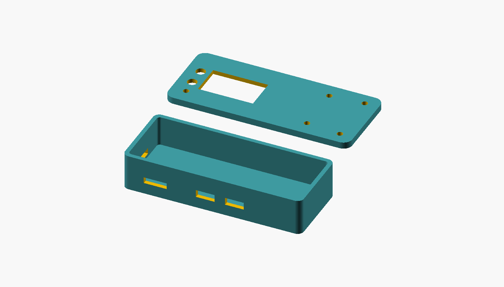
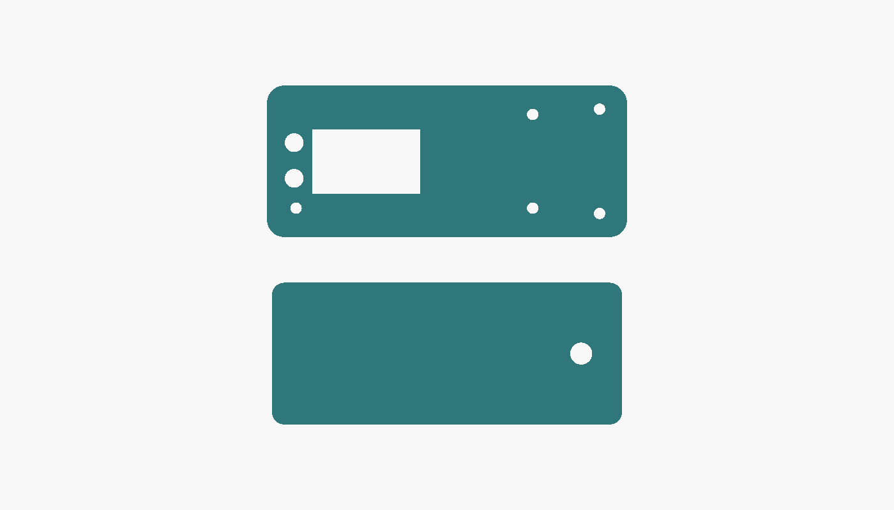
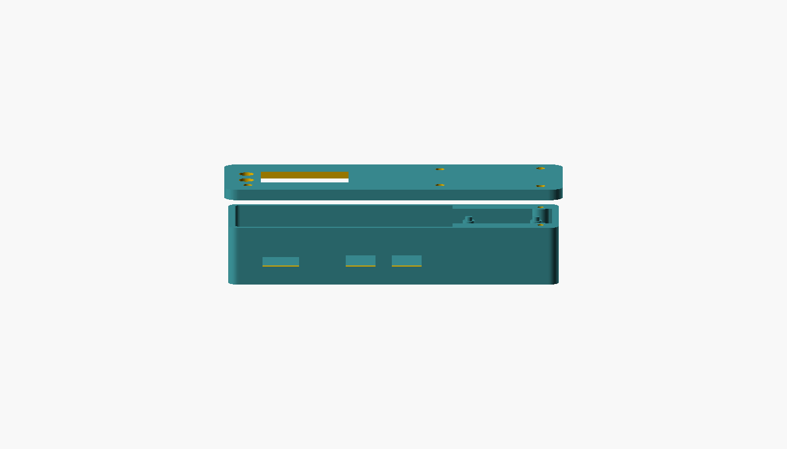

# hardware/enclosure/ — 筐体

- **対象**: RP2350-PiZero（65 × 30mm）＋ Waveshare 1.3inch LCD HAT
- **形式**: [OpenSCAD](https://openscad.org/)（テキスト。差分管理と再生成ができる）
- **ライセンス**: **CC-BY-SA-4.0**（リポジトリの [LICENSE-ENCLOSURE](../../LICENSE-ENCLOSURE)）

## なぜ SeedSigner の STL をそのまま使わないのか

**寸法は合うが、ポートの穴が合わない。**

| | SeedSigner（Raspberry Pi Zero） | 本プロジェクト（RP2350-PiZero） |
|---|---|---|
| 基板寸法 | 65 × 30mm | **同じ**（65 × 30mm） |
| 画面 | Waveshare 1.3inch LCD HAT | **同じ HAT**（65 × 30.2mm） |
| 電源・データ端子 | micro-USB ×2（左の短辺と手前の長辺） | **手前の長辺に mini HDMI ＋ USB-C ×2**（左から HDMI / PIO-USB / USB） |
| 記録媒体 | microSD（手前の長辺寄り） | **左の短辺**（カードは左から挿す） |
| 電池 | なし | **右の短辺に BAT の 2pin コネクタ**（使わないが開口しておく） |
| 取付穴 | Φ2.75 前後（機種による） | **Φ3.00 ×4**（四隅。Pi Zero と同じ配置） |
| ボタン | なし | **BOOT / RUN ボタンあり**（基板上。ケースから押せるようにするか、蓋を外して使う） |
| カメラ | Pi カメラ（QR 読み取り） | **積まない**（カメラ穴は不要） |

**HAT（Waveshare 1.3inch LCD HAT）の実物の配置**（製品写真より）:

| 部位 | 位置 |
|---|---|
| 3 ボタン（KEY1〜3） | **左の短辺に沿って縦一列** |
| LCD | 中央やや左（表示領域 23.4 × 23.4mm） |
| ジョイスティック | **右の短辺寄り、中央** |
| 取付穴 | 四隅（基板と同位置） |

そのため、既存の STL を流用すると**穴の位置が合わない**。改造して配布する場合は、
配布元のライセンス条件を引き継ぐ必要もある（配布元によって MIT / CC / 不明とばらついている。
例: [cyphergurke/seedsigner-thincase](https://github.com/cyphergurke/seedsigner-thincase) は MIT で
Inventor（.ipt）の編集可能ソース付き）。

**そこで、SeedSigner のケースは「作り方の参考」にとどめ、自前のパラメトリックな OpenSCAD を用意した。**

- ライセンスを自分たちで決められる（CC-BY-SA-4.0）
- **寸法がパラメータ**なので、部品を変えたら再生成できる
- テキストなので差分管理・レビューができる（本リポジトリの他の部分と同じ流儀）

## レンダリング結果（確認済み）



**真上からの正投影**（上蓋のレイアウト確認用）:



**正面の正投影**（前面のコネクタ穴）:



*左が下側（トレイ。四隅に HAT を押さえる支柱、右側面に USB-C の穴）、右が上蓋
（表示窓・ジョイスティック・3 ボタン）。2026-10-12 に OpenSCAD 2026.10.11 でレンダリング。*

**確認したこと**:

| 項目 | 結果 |
|---|---|
| 構文とレンダリング | `Status: NoError`（有効な多様体） |
| 下側（tray） | 外形 69.8 × 34.8 × 15.7mm ＝ 基板 65×30 ＋ 肉厚 2×2 ＋ 遊び 0.4×2 ✅ |
| 上蓋（lid） | 外形 69.8 × 34.8 × 3.5mm ✅ |
| **コネクタの向き** | 初版は USB-C を右側面に置いていたが、**公式の寸法図では手前の長辺**だったため全面修正 ✅ |
| **HAT の配置** | 初版はボタンを横一列にしていたが、**実物は左端に縦一列**だったため修正 ✅ |
| 干渉 | 表示窓とボタン穴の重なりを初版で検出して修正済み ✅ |
| 取付 | 基板の Φ3.00 の穴に合わせたボス（M2.5 の下穴）を追加 ✅ |

**まだ実測していないのは穴の位置だけ**で、外形と構造は確定している。

## 使い方

```bash
# OpenSCAD を入れる
#   macOS: 公式の配布（https://openscad.org/downloads.html）から .dmg を入れる
#          ※ Homebrew の cask は Gatekeeper の検査を通らず 2026-09-01 に無効化されている
#   Linux: apt install openscad
openscad -o zhww-case.stl hardware/enclosure/zhww-case.scad          # STL を書き出す
openscad -o tray.stl -D 'part="tray"' hardware/enclosure/zhww-case.scad
openscad -o lid.stl  -D 'part="lid"'  hardware/enclosure/zhww-case.scad

# プレビュー画像（README の画像と同じもの）
openscad -o case.png --imgsize=1000,750 --autocenter --viewall --projection=o \
  --colorscheme=Tomorrow hardware/enclosure/zhww-case.scad
```

## 実機が届いたら実測して埋めること

`zhww-case.scad` の中で **`// --- 実測して埋める ---`** の印を付けたパラメータは、
**公開情報から分からないため仮の値**になっている。実機で測って更新する。

| パラメータ | 何を測るか |
|---|---|
| `display_x` / `display_y` | HAT の基板端から LCD 表示領域までの距離（現在は写真からの読み取り） |
| `joystick_x` / `joystick_y` / `joystick_d` | ジョイスティックの中心位置と軸の直径（現在は LCD の右側という仮置き） |
| `button1..3_x/y` / `button_d` | 3 ボタンの中心位置と直径 |
| `usb_c1_x` / `usb_c2_x` / `usb_c_w/h` | USB-C ×2 の左右位置・寸法（手前の長辺） |
| `hdmi_x` / `hdmi_w/h` | mini HDMI の位置・寸法（手前の長辺の左寄り） |
| `sd_y0` / `sd_len` / `sd_h` | microSD スロットの位置・長さ・高さ（左の短辺） |
| `bat_y0` / `bat_w/h` | BAT コネクタの位置（右の短辺。任意の LiPo 改造用） |
| `hole_inset` / `hole_d` | 取付穴の位置（端からの距離）と直径（**Φ3.00 は公式図で確認済み**） |
| `header_h` | 40pin ヘッダ＋ソケットを挿したときの高さ |

**注意**: 外形と構造はレンダリングで確認済みだが、**穴の位置は実測してから確定する**。
現在の値は公開情報から分かる範囲＋妥当な仮置きであり、実機に合わせて更新すること。

## 出典（参考にした公開情報）

- RP2350-PiZero の寸法図（65.00 × 30.00mm、Φ3.00 の取付穴、2.54mm ピッチ、コネクタの配置）:
  [Waveshare wiki](https://www.waveshare.com/wiki/RP2350-PiZero) の Dimensions 画像 /
  [CNX Software](https://www.cnx-software.com/2025/07/08/rp2350-pizero-rp2350-board-with-raspberry-pi-zero-form-factor-mini-hdmi-16mb-flash/)
- 1.3inch LCD HAT の寸法 65 × 30.2mm・表示領域 23.4 × 23.4mm: [Waveshare wiki](https://www.waveshare.com/wiki/1.3inch_LCD_HAT)
- 筐体の作り方の参考（SeedSigner のコミュニティ製ケース）: [cyphergurke/seedsigner-thincase](https://github.com/cyphergurke/seedsigner-thincase)（MIT）ほか
