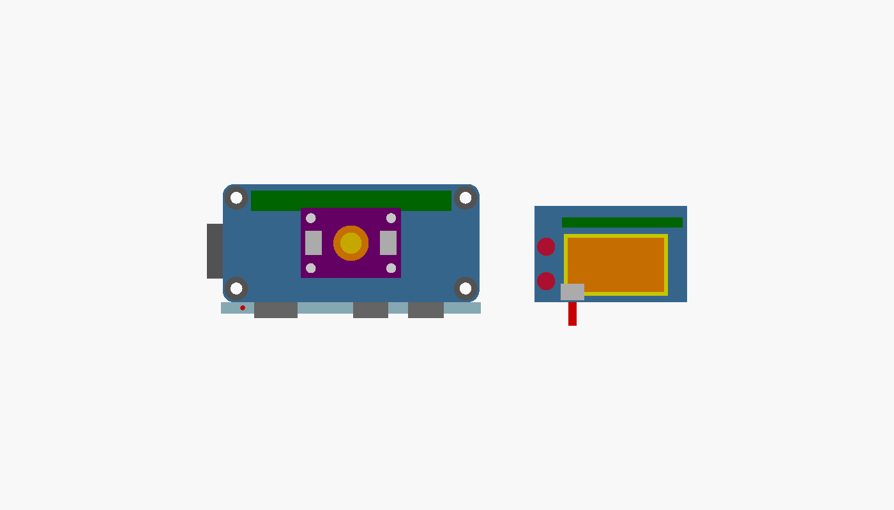

# hardware/enclosure/ — enclosure

- **Target**: RP2350-PiZero (65 × 30 mm) + **Adafruit Mini PiTFT 135×240 (#4393)** + an
  **Adafruit OPT4048 breakout (25.4 × 17.78 mm)** mounted **under the raised main board**,
  behind a short light-guide tube that looks **down through the case's floor**
- **Format**: [OpenSCAD](https://openscad.org/) (text; can be version-controlled and regenerated)
- **License**: **CERN-OHL-S-2.0** ([LICENSES/CERN-OHL-S-2.0.txt](../../LICENSES/CERN-OHL-S-2.0.txt))

## What changed in v0.5 (and why)

The light sensor now looks **down through the underside of the case**, so sending means laying
the device on the phone's screen: it self-aligns, it is hands-free, and the phone itself shields
the sensor from room light while the display keeps facing the user (the decision and its
reasoning: [docs/03-hardware-bom.md §2.11](../../docs/03-hardware-bom.md)).

| | v0.4 | **v0.5 (this one)** |
|---|---|---|
| Sensor position | in a **30 × 22 mm pocket at the right-hand end** of the case, beside the board | **under the main board**, sensor side down, with the aperture and the light guide going **down through the floor** |
| Sensor mount | four posts in the bay, pressed down by a pad on the lid | the same four posts (they enter the board's own Φ2.5 holes), but the module is now **captive between them and the board's underside** (0.6 mm of play) — the lid pad is gone |
| Main board | rested on the 3 mm floor | **raised on four 14 mm standoffs** — board underside at **17.0 mm** — so the module *and its Qwiic plug* fit underneath; three of the standoffs carry the lid screws, the fourth (rear-left, under the Mini PiTFT) is a plain support |
| Case outline | 99.8 × 34.8 × 19.5 mm | **69.8 × 37.2 × 33.5 mm** — 30 mm shorter, 14 mm taller. The footprint is the board's 65 × 30 plus walls, clearance and a **2.4 mm cable channel** at the front |
| Qwiic cable | not modelled ("check the length when the hardware is in hand") | **modelled, measured and asserted**: a 2.8 mm channel along the front wall (`cable_channel`) is the only route past the board, and the cable's four waypoints are printed by `part="check"` — **39.0 mm of the 50 mm cable**, 11.0 mm spare |
| Fasteners | five **M2.5 × 18** (three into the floor, two into bay bosses) | three **M2.5 × 25** into the standoffs — an 18 mm screw no longer reaches the standoffs now that the board is 17 mm up |
| Lid | window, 2 buttons, **5** screw holes, a pad pressing the module down | window, 2 buttons, **3** screw holes |
| v0.4's ordering fix | shell hollowed out **first**, then collar/bosses/posts/pilots added | **kept** — the shell is hollowed out first, then the standoffs, the sensor posts and the collar are added (v0.3 shipped with all of them cut away) |

The case grew in thickness instead of length because the module's 25.4 mm edge runs along the
case's long axis and it now lives in the space the board used to occupy. Height is set by one
number: `light_guide_len` (10 mm) moves the module deck, the standoffs and the lid **1:1** —
an 8 mm tube would make the case 2 mm shorter.

## What changed in v0.4 and v0.3 (history)

| | v0.3 | v0.4 |
|---|---|---|
| Light sensor | LM393-type module, ~20 × 15 mm, resting on two rails in a 16 mm bay | **Adafruit OPT4048 breakout, 25.4 × 17.78 mm**, on four posts that enter the board's own Φ2.5 mounting holes, in a 30 × 22 mm pocket |
| Light guide | printed sleeve from the floor to the module's underside | printed collar **exactly as tall as the guide** (the OPT4048 has parts within 4.5 mm of the aperture) |
| Aperture | assumed to be over the sleeve | an **explicit parameter marked as an estimate** (`opt_ap_from_left` / `opt_ap_from_front`) that the collar, the floor window and the layout drawing all follow |
| Tray internals | **bug**: v0.3 cut the cavity *after* unioning the collar, the rails and the screw pilots, so the printed tray had none of them | shell hollowed out first, features added afterwards |

| | v0.2 | v0.3 |
|---|---|---|
| Display | Waveshare 1.3inch LCD HAT (65 × 30.2 mm, 240×240) | **Adafruit Mini PiTFT #4393** (38.6 × 24.5 mm board, 1.14", 240×135, 2×12 socket) |
| Input on the display | joystick + 3 buttons on the HAT | **two tactile buttons on the module's own board** (GPIO23/24) |
| Light input | none | LM393 module in a new sensor bay |

The Mini PiTFT covers only the left half of the 40-pin header, so the rest of the header stays
reachable. The OPT4048 needs no wires to it at all: it hangs on the display's Qwiic/STEMMA QT
port, with the cable inside the case (see [docs/09-light-audio-input.md](../../docs/09-light-audio-input.md)).

## Why we do not use the SeedSigner STL as-is

**The board dimensions fit, but nothing else does.**

| | SeedSigner (Raspberry Pi Zero) | This project (RP2350-PiZero) |
|---|---|---|
| Board dimensions | 65 × 30 mm | **The same** (65 × 30 mm) |
| Display | Waveshare 1.3inch LCD HAT | **A different display**, and it is a module, not a HAT |
| Power and data connectors | micro-USB ×2 (left short edge and front long edge) | **mini HDMI + USB-C ×2 on the front long edge** (from the left: HDMI / PIO-USB / USB) |
| Storage medium | microSD (towards the front long edge) | **The left short edge** (the card is inserted from the left) |
| Battery | None | A 2-pin BAT connector on the right short edge, **inside the case** (USB power only) |
| Mounting holes | Around Φ2.75 (varies by model) | **Φ3.00 ×4** at the four corners (Pi Zero placement) |
| Light input | Camera (QR reading) | **No camera** — an OPT4048 module behind a light guide, under the board |

So reusing an existing STL means **the hole positions do not line up**. If you modify one and
redistribute it, you also have to carry over the license terms of the source (they vary: MIT / CC /
unknown. For example, [cyphergurke/seedsigner-thincase](https://github.com/cyphergurke/seedsigner-thincase) is MIT
and includes editable Inventor (.ipt) sources).

**So the SeedSigner case is kept only as "a reference for how to build one", and we provide our own parametric OpenSCAD instead.**

- We can decide the license ourselves (CERN-OHL-S-2.0, like the rest of the hardware)
- **The dimensions are parameters**, so the model can be regenerated when parts change
- It is text, so it can be version-controlled and reviewed (the same style as the rest of this repository)

## Where the numbers come from (read this before printing)

**Nothing in this file has been measured with calipers yet.** Every dimension in
`zhww-case.scad` carries one of four tags:

| Tag | Meaning |
|---|---|
| `[D]` | **Published dimension** — an official drawing, a vendor page, or the vendor's own PCB file |
| `[P]` | **Read off a product photo** — measured in pixels and scaled by a known pitch. Good to roughly ±0.5–1 mm |
| `[E]` | **Our estimate / placeholder** — no published value exists |
| `MEASURED` | A value that **must be confirmed with calipers** before the print can be trusted |

The load-bearing values:

- Board outline 65.00 × 30.00 mm, Φ3.00 mounting holes, 40-pin header at 2.54 mm pitch — the
  Waveshare RP2350-PiZero drawing `[D]`
- Mini PiTFT board 38.6 × 24.5 mm, "2×12 connector", buttons on GPIO23/24, Qwiic/STEMMA QT on the
  module's underside — the Adafruit product page and the Mini PiTFT pinouts guide `[D]`
- **Where things sit on the Mini PiTFT** (socket offset, display centre, the two button centres) —
  measured in pixels on Adafruit's top-down product photo, scaled by the socket's 2.54 mm pitch `[P]`
- Display active area 24.4 × 13.7 mm — derived from a 1.14" 240×135 panel at a 0.1016 mm dot pitch.
  **Adafruit does not publish the active area**, so this is an estimate `[E]`
- The 40-pin header's position on the board (`header_x0`, `header_y_rear`) — assumed centred /
  Pi-Zero-like `[P]`
- OPT4048 breakout board 25.4 × 17.78 mm, 2.54 mm corner radius, four Φ2.5 plated mounting holes
  at (2.54, 2.54) / (22.86, 2.54) / (2.54, 15.24) / (22.86, 15.24), the OPT4048 package U1 at
  (12.70, 8.89), one STEMMA QT connector on each short edge — Adafruit's published PCB source
  files (the Eagle `.brd`) `[D]`
- **The two ends of the Qwiic cable** — also from the published `.brd` files (`[D]`), because the
  whole cable route depends on them:
  - the display's socket (Mini PiTFT `CONN1`, mirrored onto the module's underside) sits 6.5–12.6 mm
    in from the module's left edge with its **mouth 0.5 mm in from the module's front edge, facing
    the front edge** — the cable leaves the display heading straight at the case's front wall;
  - the sensor's sockets (OPT4048 `CONN1` left / `CONN2` right) are centred on the module's y and
    face outwards; the cable takes the left one.
  Their **heights** (`qt_h` 3 mm, `qt_plug` 3.4 mm) are estimates `[E]`, not published.
- **Where the light-sensitive area sits inside that package** — not published in a form we could
  verify, so `opt_ap_from_left` / `opt_ap_from_front` are **estimates** `[E]`, and the first thing to
  measure (see below)
- The parts around the aperture on the module's underside (which is why the collar cannot rise to
  the board) — read off the same `.brd`: pull-up pack 2.9 mm from the aperture, bypass caps 1.7 / 2.4 /
  4.1 mm, regulator 2.4 mm `[D]`, their *heights* `[E]`
- Light guide "~Φ5 mm bore, 8–15 mm long" — from the project brief, never measured `[E]`
- The raised board's standoff height `standoff_h` 14 mm, `module_gap` 0.6 mm, the cable channel
  `cable_channel` 2.4 mm and the drop point `cable_drop_x` 7.5 mm — all our own numbers `[E]`,
  derived from the fits the check asserts (see "The stack-up" below)

## The stack-up (heights, verified by `part="check"`)

The board no longer sits on the floor: it is raised on four standoffs so that the sensor module and
its Qwiic plug fit underneath. Everything above it follows from that.

| Layer | Height (z, case's outside bottom = 0) |
|---|---|
| Case floor | 0–3.0 mm |
| **Board standoffs** | 3.0–**17.0 mm** (14.0 mm printed) |
| **Main board** (65 × 30 × 1.6) | **17.0–18.6 mm** |
| 40-pin header (mated) | 18.6–27.1 mm |
| Mini PiTFT board | 27.1–28.7 mm |
| Display glass / button tops | 28.7–30.7 mm |
| Lid underside | **31.5 mm** |
| Lid (display window, button holes, 3 screws) | 31.5–33.5 mm |

Under the board, in the same frame:

| Layer | Height |
|---|---|
| Light guide (inside the printed collar, collar stops at its top) | 3.0–13.0 mm |
| Estimated sensor window plane | 13.8 mm |
| **OPT4048 module PCB** (sensor side down) | **14.8–16.4 mm** |
| its Qwiic shell + mated plug | 11.8–14.8 mm |
| the module's four post spigots reach | 16.0 mm |
| Board underside | 17.0 mm — **0.6 mm above the module**, **1.0 mm above the spigots**, 4.0 mm above the collar |

`part="check"` prints all of those and asserts the three clearances, so a longer light guide or a
thicker module cannot silently collide with the board. The module is *captive* in that 0.6 mm: the
posts carry it, and if the case is turned over it rests on the board's underside instead of falling
onto the light guide.

## The light sensor, under the board

- the module is **centred on the board** (board x 19.8–45.2, y 6.11–23.89), which puts the
  estimated aperture at case (34.9, 19.8) — within 0.1 mm of the centre of the case's footprint, so
  laying the device on a phone does not need any particular alignment;
- **four posts** (`post_d` 3.6 mm shoulders with Φ2.2 mm spigots) enter the module's own Φ2.5
  mounting holes; the shoulder sits under the Φ4.0 plated pad ring and the spigot passes 1.2 mm into
  the 1.6 mm hole. A hand-placed module could otherwise slide 19 mm;
- a **Φ5.4 mm light window** straight through the floor (`light_window_d`) with a printed **collar**
  (Φ9 outer, Φ6.4 bore) above it, rising to the top of the guide;
- the user's **opaque light guide** (Φ5 bore, Φ6 outer, 10 mm in the model) drops into the collar and
  lands on the floor, which closes the ring around it;
- the module's Qwiic shell hangs 3 mm below its PCB, and there is **8.8 mm of room** between the
  shell and the floor for the plug and its cable.

**The aperture is still an estimate.** The collar, the floor window and the layout drawing are all
placed from `opt_ap_from_left` / `opt_ap_from_front` — the sensing area's distance from the module's
left edge and its front edge. Both default to the board's centre (12.70, 8.89), because Adafruit's
published PCB files put the OPT4048 *package* exactly there and their top-down photo agrees. The
position of the light-sensitive spot *inside* that 2.2 × 1.2 mm package is not published in a form we
could verify, so **treat both numbers as ±1–2 mm placeholders**. This is the one thing to measure with
calipers: centre of the clear window, from the module's left long edge and from its front short edge.
Change the two numbers, re-render, and the collar and the window follow.

Mounting orientation (so the two numbers mean something): the module goes in **sensor side down**,
its 25.4 mm edge along the case's x, its 6-pin-header edge (VIN/SCL/INT) towards the case's **rear**
wall. Turning the board over mirrors its own y axis, so the "front edge" in the parameter names is
the module's y = 17.78 edge — the silk "OPT4048 XYZ Color" edge in Adafruit's photo. The two STEMMA
QT sockets end up on the module's left and right edges; the cable takes the **left** one. **Leave the
6-pin header unsoldered**: the Qwiic cable is the whole point of this module, and the header's pins
would hang into the space the cable runs through.

The collar stops at the top of the light guide rather than at the module because the OPT4048 breakout
has parts on the same side as the sensor, close to the aperture: the nearest bypass cap 1.7 mm out,
the regulator 2.4 mm, a second cap 2.4 mm, the pull-up pack 2.9 mm, a third cap 4.1 mm (all from the
published board file — the collar's radius is 4.5 mm). The module's PCB therefore sits `guide_to_pcb`
(1.8 mm) above the guide's top, which clears the tallest of them (a SOT23-5, ~1.45 mm `[E]`) and
leaves the guide's mouth `guide_to_pcb - opt_pkg_h` (**0.8 mm**) below the estimated window plane.

Set `light_guide_od` to the real tube's outer diameter before printing (the bore is
`light_guide_od + 0.4`); if your tube is longer than 10 mm, raise `light_guide_len` — the collar, the
module, the standoffs, the lid and the whole case height follow it, and the assertions guard the
collisions that a longer tube would cause.

## The Qwiic cable: does 50 mm reach? (v0.5's other question)

**Yes — 39.0 mm of a 50 mm cable, 11.0 mm spare — but only because v0.5 adds a channel for it.**

- The display's socket is on the Mini PiTFT's **underside**, its mouth 0.5 mm in from the module's
  front edge and facing it (from Adafruit's `.brd`), so the cable leaves the display heading at the
  case's front wall.
- To reach the sensor it has to get **below the board** — and the board sits only `clearance`
  (0.4 mm) from the wall. At 0.4 mm there is *no* route around the board's edge at all, on any side,
  for a 2.6 mm ribbon.
- So the interior is `cable_channel` (2.4 mm) deeper than the board: that leaves a
  **2.8 mm slot along the front wall**, full height, open from the display gap down into the cavity
  under the board. It is interrupted only where the HDMI and the two USB-C cut-outs tunnel across it
  to reach the board's edge, so the cable drops at **case x 7.5**, to the left of the HDMI cut-out
  (which starts at case x 10.4), in front of the microSD cut-out rather than across it.
- The route the model measures (plug back → channel → plug back): **6.1 mm across to the channel,
  12.3 mm down past the board's edge, 20.5 mm to the sensor's socket**. Rounding the two corners with
  a real cable's bend radius only shortens it slightly; `part="check"` asserts the total stays
  **5 mm inside the 50 mm budget** and fails the render when a parameter moves the module too far.

Set `cable_channel = 0` for a 69.8 × 34.8 mm case if you would rather run a 100 mm cable out of a
cut-out — but then the sensor cannot be fed with the case closed, which is the point of the design.

## The display window is *not* 38.6 × 24.5 mm (and why)

The Mini PiTFT's **board** is 38.6 × 24.5 mm. The lid's window is **26.4 × 15.7 mm**, because the
module's two tactile buttons are on that same 38.6 × 24.5 mm face, in a vertical pair at its left
edge. A window the size of the whole board would swallow both buttons and leave nothing to press.

So the numbers are used like this:

- **38.6 × 24.5 mm** — the module's board outline. The case *fits* it (the cavity, the lid height and
  the screw positions are built around it), and the module's left and rear edges end up flush with
  the Pi's board edges, as in Adafruit's own "mounted on a Pi Zero" photo.
- **26.4 × 15.7 mm** — the actual window in the lid: the display's active area (24.4 × 13.7 mm) plus
  a 1.0 mm margin on every side (`window_margin`). It keeps a **2.17 mm** wall to the button holes.

`part="check"` prints those rectangles — and the stack-up, the collision checks, the aperture
estimate and the cable route with them — and asserts that none of them stop fitting:

```
ECHO: "zhww-case: display window x 7.51..33.91  y 7.08..22.78  (26.4 x 15.7 mm)"
ECHO: "zhww-case: button holes Φ4.6 at [3.04, 19.58] and [3.04, 10.83]  (x 0.74..5.34)"
ECHO: "zhww-case: window-to-button gap = 2.17 mm  PASS"
ECHO: "zhww-case: stack-up [mm above the case's outside bottom]"
ECHO: "zhww-case:   floor 0..3 | board standoffs 3..17 (14 printed)"
ECHO: "zhww-case:   board 17..18.6 | header 18.6..27.1 | Mini PiTFT 27.1..28.7 | glass/buttons to 30.7 | lid underside 31.5 | case top 33.5"
ECHO: "zhww-case:   sensor: light guide 3..13 (collar stops there too) | module PCB 14.8..16.4 | its Qwiic shell hangs 11.8..14.8 | board underside 17"
ECHO: "zhww-case:   case 69.8 x 37.2 x 33.5 mm outside (board 65 x 30 + 0.4 clearance + 2 walls + 2.4 front channel)"
ECHO: "zhww-case: check board vs sensor module: 17 - 16.4 = 0.6 mm  PASS"
ECHO: "zhww-case: check board vs light-guide collar: 17 - 13 = 4 mm  PASS"
ECHO: "zhww-case: check board vs sensor-post spigots: 17 - 16 = 1 mm  PASS"
ECHO: "zhww-case: check Qwiic plug under the module: 11.8 - 3 = 8.8 mm of cable room above the floor  PASS"
ECHO: "zhww-case: sensor module 25.4 x 17.78 mm under the board at board x 19.8..45.2  y 6.11..23.89  (board is 0..65 x 0..30; 19.8 mm and 6.11 mm to its edges)"
ECHO: "zhww-case: aperture *** ESTIMATE, NOT MEASURED *** 12.7 mm from the module's left edge + 8.89 mm from its front edge → case x 34.9 y 19.8 of 69.8 x 37.2  (from the other two edges: 12.7 + 8.89 mm)"
ECHO: "zhww-case: light guide's mouth is 0.8 mm below the estimated sensor window plane  (guide_to_pcb 1.8 - opt_pkg_h 1)"
ECHO: "zhww-case: Qwiic cable: channel 2.8 mm wide at case x 7.5, route 38.9693 mm (display plug → channel → sensor plug) of a 50 mm cable → 11.0307 mm spare  PASS"
```

The assertions behind them: window-to-button gap > 1.0 mm, the window and both button holes inside
the Mini PiTFT's board, the module's mounting holes consistent with its outline, the aperture on the
module, the collar inside the board's footprint and clear of both the module posts and the board
standoffs, the module fully under the board and clear of the standoffs, **the raised board clear of
the module, the collar and the post spigots**, room under the module for the Qwiic plug, the floor
window narrower than the collar's bore, the cable's drop point clear of the wall and the HDMI
cut-out, and the cable route inside the 50 mm budget. Move a parameter past any of those limits and
the render fails instead of producing an unusable STL.

If the real modules turn out to differ, the parameters to change are `tft_lcd_dx`, `tft_lcd_dy`
(where the display sits), `tft_btn_dx`, `tft_btn_dy` (where the buttons sit) and `window_margin`.

## Rendered results (verified)


*Left is the tray (front connector cut-outs, microSD on the left edge), right is the lid (display
window, two button holes, three screw holes). The light window is in the tray's floor, in the middle
— under the board, where the sensor sits.*

**Orthographic projection from directly above** (lid layout, and the tray with its floor window):


**Front projection of both parts** (the three connector openings on the front long edge; tilted 12°
so the openings read instead of vanishing edge-on):


**Cross-section (isometric, front half cut away at the aperture's y)** — the raised board, the
header, the Mini PiTFT with its display glass and buttons, the OPT4048 module *underneath*, and the
Qwiic cable drawn whole (it crosses the cut plane, so cutting it would hide the answer to the cable
question):


**What we verified** (OpenSCAD 2026.10.11, `--render`, every mode prints `Status: NoError`):

| Mode | Status | Genus | Vertices | Facets |
|---|---|---|---|---|
| `part="tray"` | `NoError` | 5 | 1968 | 3952 |
| `part="lid"` | `NoError` | 6 | 750 | 1520 |
| `part="all"` | `NoError` | 10 | 2718 | 5472 |
| `part="section"` | `NoError` | 6 | 2038 | 4096 |
| `part="check"` | `NoError` | 3 | 2227 | 4462 |

`Genus` is OpenSCAD's own line, which is computed as `1 - χ/2` and therefore ignores the number of
shells — for the multi-shell modes it is not the sum of the parts' genera.

Reading the STLs back out (edges shared by exactly two triangles, Euler characteristic per shell):

| Export | Shells | Genus per shell | Non-manifold | Open | Flipped |
|---|---|---|---|---|---|
| `tray` | 1 | 5 (HDMI + 2× USB-C + microSD + light window) | 0 | 0 | 0 |
| `lid` | 1 | 6 (window + 2 buttons + 3 screws) | 0 | 0 | 0 |
| `all` | 2 | 6, 5 | 0 | 0 | 0 |
| `section` | 4 | 9, 0, 0, 0 | 0 | 0 | 0 |
| `check` | 2 | 4 (the board panel's four mounting holes), 0 | 0 | 0 | 0 |

The same read-back **probes the tray with a ray cast** (this is v0.4's regression check: v0.3 cut the
cavity last and lost the collar, the posts and the pilots): the collar's wall is solid and its bore is
air, two of the four sensor posts are solid, all four standoffs are solid, the three screwed standoffs
have their Φ2.05 pilot bores while the rear-left one has none, the cable channel is air and the floor
beside the collar is solid — **12/12 probes agree**.

The outer sizes come out at **69.8 × 37.2 × 31.5 mm** for the tray, **72.2 × 39.6 × 3.2 mm** for the
lid (2.0 mm plate plus a 1.2 mm skirt that drops over the tray, which overhangs by 1.2 mm on each
side) and **33.5 mm** tall once assembled. Measured off the STL, the floor window is Φ5.4 at case
(34.9, 19.8), the lid's display window is 26.40 × 15.70 mm at case x 9.91–36.31, y 11.88–27.58, and
the two button holes are Φ4.60.

## Layout check drawing (for comparing against the real modules)

Two panels, side by side and to scale: the **raised board with everything that lives under it**
(left), and the **Mini PiTFT in its own coordinates** (right — overlaying it on the board would make
them look like they interfere because of the height difference).



How to read it (left panel, in the model's board coordinates — the case's front is at the bottom,
the microSD end at the left): blue = the board, with its four Φ3.00 mounting holes; grey rings = the
four printed standoffs; green = the 40-pin header; grey tabs = the front connectors and the microSD
opening; light blue strip = the **cable channel** with the drop point as a red dot; purple = the
**OPT4048 module under the board**, with its four Φ2.5 mounting holes (white) and its two Qwiic
sockets (grey); orange ring = the light-guide collar, gold dot = the floor's light window (**both
placed from the estimated aperture**).

Right panel, drawn the way Adafruit's overhead photo is (the socket at the top/rear edge, the buttons
at the left): blue = the module's board, green = its 2×12 socket, yellow = the lid's display window
with the active area (orange) inside it, red = the two button holes, grey = the **STEMMA QT/Qwiic
socket on the module's underside**, and the red bar = the direction its cable leaves in (straight at
the case's front wall, which is what makes the 39 mm route possible).

Print it at 1:1 on paper and lay the real boards on it: the left panel is the one that tells you
whether `opt_ap_from_left` / `opt_ap_from_front` (and the module's four hole positions) are right —
correct that one first.

## Usage

```bash
# Install OpenSCAD
#   macOS: install the .dmg from the official distribution (https://openscad.org/downloads.html)
#          (the Homebrew cask does not pass Gatekeeper checks)
#   Linux: apt install openscad
openscad -o zhww-case.stl hardware/enclosure/zhww-case.scad          # export the STL
openscad -o tray.stl -D 'part="tray"' hardware/enclosure/zhww-case.scad
openscad -o lid.stl  -D 'part="lid"'  hardware/enclosure/zhww-case.scad

# self-check: prints the stack-up, the collision checks, the window/button/aperture numbers and
# the Qwiic cable's route, and asserts that none of them collide
openscad -o check.png --render -D 'part="check"' hardware/enclosure/zhww-case.scad
```

The images above were regenerated with (macOS path shown; `--autocenter --viewall` does the framing):

```bash
OSCAD=/Applications/OpenSCAD.app/Contents/MacOS/OpenSCAD
D=hardware/enclosure/zhww-case.scad
C="--render --imgsize=1400,800 --projection=o --colorscheme=Tomorrow --autocenter --viewall"

$OSCAD -o docs/images/case-iso-v2.png     $C --camera=0,0,0,55,0,25,180 -D 'part="all"'     $D
$OSCAD -o docs/images/case-top-v2.png     $C --camera=0,0,0,0,0,0,180   -D 'part="all"'     $D
$OSCAD -o docs/images/case-front-v2.png   $C --camera=0,0,0,78,0,0,180  -D 'part="all"'     $D
$OSCAD -o docs/images/case-section.png    $C --camera=0,0,0,55,0,25,180 -D 'part="section"' $D
$OSCAD -o docs/images/layout-check.png    $C --camera=0,0,0,0,0,0,180   -D 'part="check"'   $D
cp docs/images/case-iso-v2.png docs/images/case-preview.png   # the name docs/03-hardware-bom.md uses
```

(The commands are written from the repository root; from anywhere else, prefix the two paths with the
path to the checkout.)

**Fasteners**: three **M2.5 × 25 mm** self-tapping screws. Each passes through the lid, through one
of the board's own Φ3.00 mounting holes, and bites into a blind pilot (11 mm deep) in a standoff.
Three screws, not four: the board's rear-left corner has a standoff — the board needs all four to
rest on — but **no screw**, because the Mini PiTFT's board is over that corner and a screw could not
be inserted there. An 18 mm screw (v0.4's length) no longer reaches: the board is 17 mm up, so the
screw has to be 25 mm.

## Deliberately not in this version

- **No Qwiic/STEMMA QT opening.** The cable runs entirely inside, through the front channel, and
  nobody has run a real one yet — check the bend radius and the plug's height (`qt_h`, `qt_plug`) when
  the hardware is in hand. The route has ~11 mm of slack, so a slightly different path is fine.
- **No header pins on the OPT4048 module.** Use the Qwiic cable; a soldered 6-pin header would hang
  into the space the cable runs through.
- **No BAT opening.** Power is USB only, so the 2-pin BAT connector sits inside the case (the numbers
  are still in the .scad for a future LiPo version, which would need a new opening).
- **No fourth lid screw** at the board's rear-left corner (see above).
- **No lid pad holding the sensor module.** It has nothing left to press: the board is above the
  module now, and the 0.6 mm gap between them is what keeps the module on its posts.

## Parameters to measure and fill in once the hardware is in hand

The parameters tagged **`MEASURED`** in `zhww-case.scad` (plus everything tagged `[E]`, and the
aperture in particular) are **placeholders or readings off photos and published board files, not
measurements**:

| Parameter | What to measure |
|---|---|
| **`opt_ap_from_left` / `opt_ap_from_front`** | **The sensor's aperture** — the centre of the clear window, from the module's left long edge and its front short edge. Currently the board's centre (12.70, 8.89) *because Adafruit's board file puts the package there*, not because anyone measured the spot inside the package. **This moves the collar and the floor window — measure it first** |
| **`standoff_h` / `module_gap`** | That the raised board really clears the module with the plug fitted. 14 mm is the minimum that clears the *modelled* stack (module PCB 14.8–16.4), with 0.6 mm of air; if the real module or its plug is taller, raise `standoff_h` (and the case grows with it) |
| **what hangs below the main board** | The model assumes a flat underside (the microSD card is drawn *above* the board). If the socket or the soldered header pins stand below it, both `module_gap` and the cable's route under the board change — and the microSD cut-out's height (now at board level, 18.5–21.5 mm) has to move with the card |
| **`qt_h` / `qt_plug` / the two sockets' positions** | The Qwiic shells' height and how far a mated plug sticks out (3.0 / 3.4 mm here, `[E]`), plus the socket positions taken from the two `.brd` files — confirm them on the real boards, since the whole 39 mm route is built on them |
| **`cable_channel` / `cable_drop_x`** | Whether a 2.8 mm channel really passes a Qwiic ribbon, and whether the drop point at case x 7.5 clears the HDMI cut-out on the real board |
| `opt_pkg_h` / `guide_to_pcb` | How far the sensor package hangs below the module's PCB, and the gap from the light guide's top to that PCB. Together they set how far the guide's mouth sits below the window plane (0.8 mm now) |
| `post_spigot_d` / `post_d` | The module's Φ2.5 holes and the Φ4.0 pad rings (the `.brd` says 2.54 mm in from each edge; confirm on the board and file the spigots to fit) |
| `light_guide_od` / `light_guide_id` / `light_guide_len` | Your actual light-guide tube; the collar's bore is `light_guide_od + 0.4` and its height follows the guide — and so does the whole case height |
| `header_x0` / `header_y_rear` | Where the 40-pin header actually sits on the board. **The display window's position depends on this** |
| `hole_inset` / `hole_d` | Mounting hole position and diameter (Φ3.00 is confirmed in the drawing; the 3.5 mm inset is assumed — Adafruit's own library draws the Pi's holes at Φ2.8) |
| `header_h` | Height from the board's top face to the Mini PiTFT's PCB with the socket mated. **Every case height follows this one** |
| `tft_left_off` / `tft_rear_off` | Where the module's board sits relative to its 2×12 socket (currently read off Adafruit's photo; the `.brd` puts the module at y 6.35–30.73 against the model's 5.48–29.98, ~0.9 mm apart) |
| `tft_lcd_dx` / `tft_lcd_dy` | Where the display's active area sits on the module (`[P]`; ±1 mm would show as an off-centre window) |
| `tft_lcd_w` / `tft_lcd_h` | The active area (`[E]`, derived from the diagonal — measure the lit rectangle) |
| `tft_btn_dx` / `tft_btn_dy` / `tft_btn_d` | The two buttons' centres and actuator diameter, and the module's PCB thickness (`tft_t`, `tft_glass_t`, `tft_btn_h`) |
| `usb_c1_x` / `usb_c2_x` / `usb_c_w/h`, `hdmi_x` / `hdmi_w/h` | Connector positions and sizes on the front long edge (read off the drawing) |
| `sd_y0` / `sd_len` / `sd_h` | microSD slot position, length and height (left short edge) |
| `clearance`, `wall`, `skirt_gap` | Print tolerances on your machine |

**Note**: the shape and the structure have been verified by rendering (manifold, no interference in
the model), but **nothing here has been caliper-measured**, and the aperture is an outright estimate.
Print the `part="check"` drawing at 1:1 on paper, lay the real boards on it, and correct the numbers
before committing to a long print.

## Sources (public information we referenced)

- RP2350-PiZero dimension drawing (65.00 × 30.00 mm, Φ3.00 mounting holes, 2.54 mm pitch, connector
  placement): the Dimensions image on the [Waveshare wiki](https://www.waveshare.com/wiki/RP2350-PiZero) /
  [CNX Software](https://www.cnx-software.com/2025/07/08/rp2350-pizero-rp2350-board-with-raspberry-pi-zero-form-factor-mini-hdmi-16mb-flash/)
- Mini PiTFT 135×240 (#4393) board dimensions 38.6 × 24.5 × 7.6 mm, two tactile buttons,
  Qwiic/STEMMA QT: [Adafruit product page](https://www.adafruit.com/product/4393) ("On the bottom we
  have a Qwiic/STEMMA QT connector") and the
  [Mini PiTFT pinouts guide](https://learn.adafruit.com/adafruit-mini-pitft-135x240-color-tft-add-on-for-raspberry-pi/pinouts)
  ("both versions have the same 2×12 connector", GPIO23/24 for the buttons). Button, socket and
  display positions were measured on the product's overhead photo.
- **The display's Qwiic socket position and orientation**: Adafruit's published PCB source files,
  [adafruit/Adafruit-Mini-PiTFT-240x135-TFT-PCB](https://github.com/adafruit/Adafruit-Mini-PiTFT-240x135-TFT-PCB)
  (the Eagle `.brd`: `CONN1`, a JST_SH4 on the bottom side, shell x 6.525–12.625 of the module's
  38.1 mm, mouth 0.5 mm in from the module's front edge). The product photo of the module's back
  agrees.
- **OPT4048 breakout**: board outline 25.4 × 17.78 mm, the 2.54 mm corner radius, the four Φ2.5
  mounting holes, the package U1 at (12.70, 8.89), the two STEMMA QT sockets' positions, and the
  positions of the parts around the aperture — all from Adafruit's published PCB source files,
  [adafruit/Adafruit-OPT4048-XYZ-Color-Sensor-PCB](https://github.com/adafruit/Adafruit-OPT4048-XYZ-Color-Sensor-PCB)
  (the Eagle `.brd`). The [product page](https://www.adafruit.com/product/6335),
  [pinouts guide](https://learn.adafruit.com/adafruit-opt4048-xyz-color-sensor/pinouts) and the
  [Switch Science listings](https://www.switch-science.com/products/10457) cover the rest (0x44,
  ADDR jumper, level shifter, Qwiic ×2). **What none of them state is where the light-sensitive area
  sits inside the package** — that is the estimate in this model.
- OPT4048 as the light receiver (600 µs conversion, the wideband channel, why it beats a lux sensor),
  the "sensor faces the bottom" decision and the 50 mm Qwiic cable:
  [docs/09-light-audio-input.md](../../docs/09-light-audio-input.md) and
  [docs/03-hardware-bom.md](../../docs/03-hardware-bom.md) (§2.10–2.11)
- Reference for how to build the enclosure (community-made SeedSigner cases): [cyphergurke/seedsigner-thincase](https://github.com/cyphergurke/seedsigner-thincase) (MIT) and others
