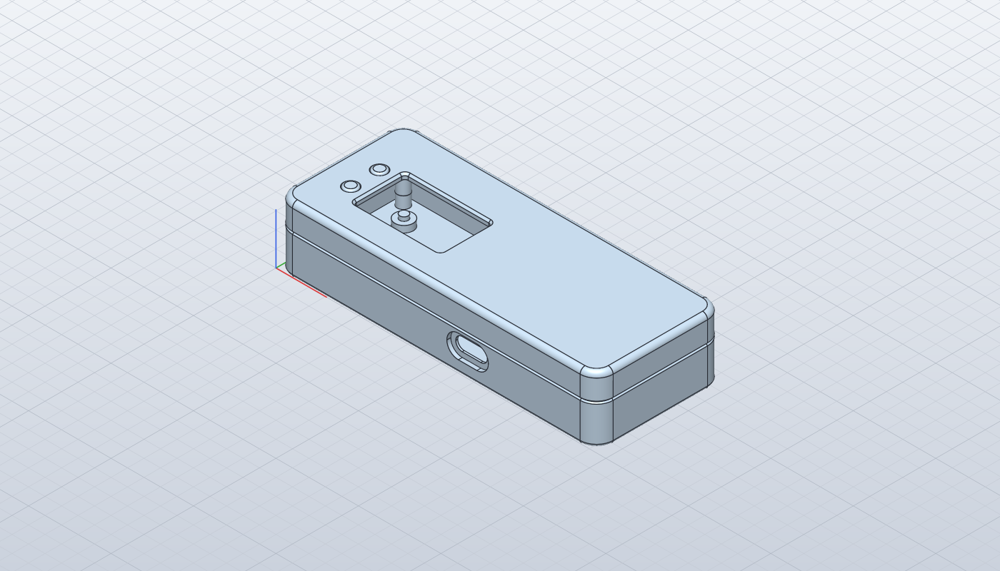
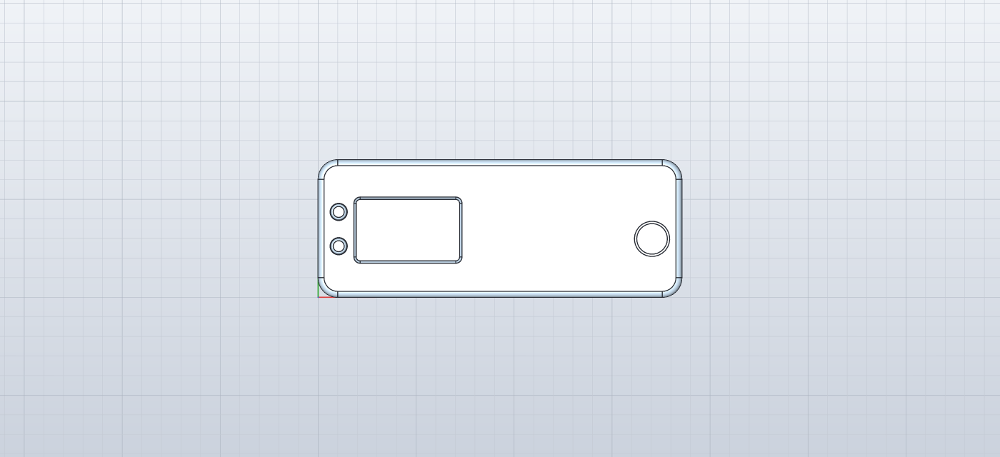
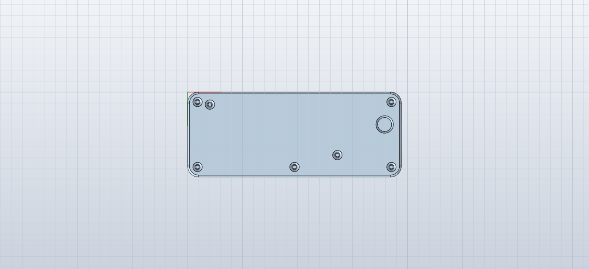
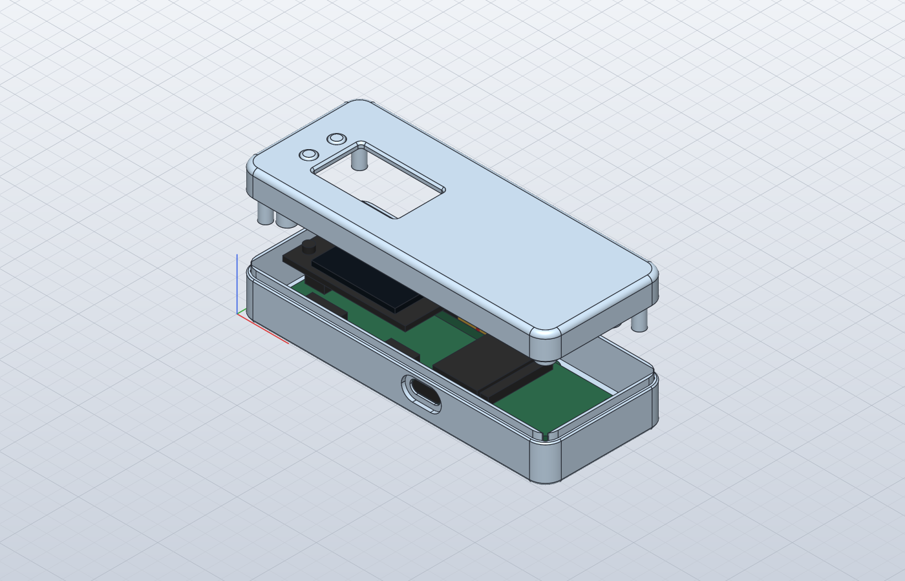
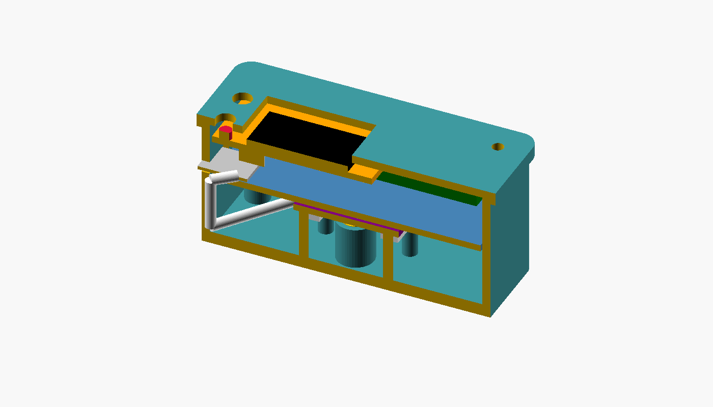

# hardware/enclosure/ — enclosure

- **Hardware**: Waveshare RP2350-PiZero (65 × 30 mm) + **Adafruit Mini PiTFT 135×240 (#4393)** on the
  left 24 pins of the 40-pin header + **ArduCam UC-805** (Arducam B0315, Himax HM01B0 monochrome
  camera) at the right-hand end, **looking out through the floor**. USB power only.
- **Size**: **92.8 × 35.1 × 19.7 mm** outside (feet add about 1.5 mm)
- **CAD**: [SolidCraft](https://github.com/bherbruck/solidcraft) 0.8.0 (MIT OR Apache-2.0). The source is
  [case.zig](case.zig): it holds every dimension, computes the clearances, and writes the SolidCraft
  command scripts in this directory
- **Material**: a **clear** filament or resin is recommended (see [Why clear](#why-clear))
- **License**: **CERN-OHL-S-2.0** ([LICENSES/CERN-OHL-S-2.0.txt](../../LICENSES/CERN-OHL-S-2.0.txt))



| Top | Bottom |
|---|---|
|  |  |

*Top: the display window, the two button caps, and the aiming ring over the lens. Bottom: four
countersunk screws, four foot pockets, the lens opening and the engraved name and licence.*



*The top lifted off. Left: the board with the Mini PiTFT on its header. Right: the camera board, lens
down, on its posts; its jumper housings (black) lie over the board's right-hand end.*



*A cut along the lens axis: the board on its standoffs, the Mini PiTFT on the header, and the camera
board at the right with the HM01B0 module hanging down to the opening in the floor.*

## Files

| File | What it is | Edit it? |
|---|---|---|
| [case.zig](case.zig) | **The source.** Every dimension (tagged with where it comes from), the geometry, the checks | **Yes** |
| [solidcraft.zig](solidcraft.zig) | A small writer for SolidCraft command scripts | Rarely |
| `zhww-case.json` | The printable parts: base, top, two button caps | No — generated |
| `zhww-case-check.json` | The same, plus the bought parts at their modelled positions and SolidCraft's interference check | No — generated |
| `zhww-case-export.json` | The parts, then the STEP and the STLs (the top turned over for printing) | No — generated |
| `zhww-case.step` | The assembled case for other CAD tools (four bodies) | No — exported |
| `zhww-case-base.stl`, `zhww-case-top.stl`, `zhww-case-cap.stl` | What to print (the cap twice) | No — exported |

The scripts are text, one SolidCraft command per line, so a change to `case.zig` shows up as a
readable diff. CI regenerates them and fails if the committed copies differ.

## Rebuilding

```bash
cd hardware/enclosure
zig test case.zig                     # the checks (and, through its import, the script writer's tests)
zig test solidcraft.zig               # the script writer on its own
zig run case.zig -- write             # prints the stack-up and every check, then writes the three scripts
zig run case.zig -- check             # what CI runs: the checks, and the scripts are up to date
```

Exporting and verifying needs `solidcraft-cli` (the macOS download is `solidcraft-cli-0.8.0-macos-universal.zip`
on the [releases page](https://github.com/bherbruck/solidcraft/releases); check it against `SHA256SUMS.txt`):

```bash
solidcraft-cli run zhww-case-export.json                               # writes the STEP and the three STLs here
mkdir -p build                                                         # ignored by git; holds local results
solidcraft-cli run zhww-case-check.json --results > build/results.json  # SolidCraft's interference check
zig run case.zig -- verify build/results.json                          # passes only if nothing overlaps
```

To open the model in the SolidCraft app, save the check script as a design and open that:
`solidcraft-cli run zhww-case-check.json --save build/zhww-case.solidcraft`.

The pictures above:

```bash
zig run case.zig -- views build           # the exploded and the cut-away scripts (not committed)
solidcraft-cli snapshot zhww-case.json --out ../../docs/images/case-iso.png --width 1400 --height 800 --view iso
solidcraft-cli snapshot zhww-case.json --out ../../docs/images/case-top.png --width 1400 --height 640 --view top
solidcraft-cli snapshot zhww-case.json --out ../../docs/images/case-bottom.png --width 1400 --height 640 --view bottom
solidcraft-cli snapshot build/view-exploded.json --out ../../docs/images/case-exploded.png --width 1400 --height 900 --view iso
solidcraft-cli snapshot build/view-section.json --out ../../docs/images/case-section.png --width 1400 --height 800 --view iso
```

**Verified** (SolidCraft 0.8.0, 2026-10-14): every check below passes; every part builds as one closed
solid; the interference check covers the 4 printed parts and 22 bought parts and finds **no overlap**
except the four expected ones (each bare terminal drawn round its own header pin). Two boolean steps
log a tolerance retry of 0.05 mm, which is below what any printer resolves.

## The layout, and why

**Thin first.** The height is set by the display stack: board, the Mini PiTFT on its header, the
display glass and the buttons, then 0.5 mm of air and a 1.6 mm top plate.

| Layer | Height (z, outside bottom = 0) |
|---|---|
| Floor | 0–1.8 |
| Board (on four standoffs) | 3.8–5.4 |
| 40-pin header's plastic | 5.4–7.9 |
| Mini PiTFT board | 13.9–15.5 |
| Display glass / button tops | to 17.5 |
| The four bare wire terminals on the header, with the wire turning flat | to 17.6 |
| Top plate | **18.1–19.7** |

**The camera beside the board, looking down.** The camera points away from the user, as on SeedSigner:
you hold the device, aim its back at the phone's screen and watch the progress on its own display.
Under the board the camera would add about 6 mm of height; beside the board it costs 23 mm of length
instead and the case stays at the display's height. The UC-805 lies **component side down**: the
HM01B0 module hangs from it to 3.3 mm above the floor, over an opening countersunk from below so the
60° field of view is not clipped (the checks compute the cone at the floor's top, the countersink's
edge and the bottom face). The lens tip is 5.1 mm above the bottom face, so the device lies flat and
the lens never touches the table.

**The camera's header points back over the board.** Its 1×8 right-angle header (only the odd row is
fitted) is on the camera board's back, so the eight female housings plugged onto it lie flat, 9.7–12.2
mm up, over the board's right-hand end — 0.3 mm above the BAT connector and 0.33 mm in front of the
40-pin header (both estimates: **measure them**).

**Bare terminals on the 40-pin header.** The four camera signals must reach header pins, and a standard
jumper housing is 14 mm long: on a header pin it stands about 18 mm above the board, 6 mm above the
display. So the four header-side ends lose their plastic housing and get heat-shrink instead (see
[Assembly](#assembly)). They are **chequered across the two header rows** (pins 29, 32, 33, 36), so no
two of them stand side by side at 2.54 mm.

**Screws from underneath, nothing on top.** Four M2 × 16 flat-head screws come up through the floor:
two through the board's own front-left and rear-right holes, two through the camera board's holes,
into blind pilots in bosses hanging from the top. The camera is clamped between its posts and those
bosses, and a rib on the top presses its header edge down. The board's other two holes take
locating pins. The front-left boss passes beside the Mini PiTFT's front edge and is flattened on that
side.

**Commercial details.** Both shells are cut from the same rounded outline (R5 in plan, R1.5 along the
top, R0.8 along the bottom), so they meet without a step; a 0.4 mm V-groove on the parting line hides
the joint; a 1.2 mm lip on the base locates the top all round and blocks the gap. The display window
is rounded and chamfered, the button caps are captive (a flange in a counterbore under the top
plate) and stand 0.4 mm proud, and the power USB-C opening is a stadium with a shallow pocket so an
overmoulded plug seats fully. Only that one connector is open: the mini HDMI and the PIO-USB stay
behind the wall (an air-gapped signer has no use for them), and so does the microSD slot: the
project does not exchange data on cards.

## Why clear

Each user builds and opens their own device, so a tamper-evident seal would only prove that its owner
closed it — the project no longer asks for one. A **clear case** does the useful part instead: the
boards, the chips and every wire stay visible, so before each use you can compare the inside with your
own photo of it from assembly day, without opening anything (see
[docs/05-threat-model.md](../../docs/05-threat-model.md) §4-3).

| Process | Material | Result |
|---|---|---|
| Resin (SLA / MSLA, or a print service's "transparent resin") | Clear resin, post-cured; clear-coat the outside for a glass look | The clearest. Brittle under the screws: drive them in gently |
| FDM | Clear / "transparent" PETG | Translucent rather than glassy, but boards and wires are easy to make out. Print the walls as solid perimeters (no infill pattern inside them), slower and a little hotter for clarity |
| FDM | Clear polycarbonate | Tougher, needs a hot enclosure printer |

Any opaque material works mechanically; it just gives up the inspection.

## Printing

| Part | Orientation (as exported) | Supports |
|---|---|---|
| `zhww-case-base.stl` | Floor on the bed | None (the USB-C opening's top is a short arch) |
| `zhww-case-top.stl` | **Outside face on the bed** (exported turned over) | None: the bosses point up |
| `zhww-case-cap.stl` × 2 | Pressing end on the bed | None (a 1.1 mm flange overhang) |

0.2 mm layers or finer. The engraving and the lens countersink are on the bed side of the base; the
display window's chamfer and the aiming ring are on the bed side of the top. A printer that runs
large tolerances should loosen `lip_gap`, `cap_hole_d` and `clearance` in `case.zig` rather than the
STL.

## Bill of materials for the case

| Qty | Part | Note |
|---|---|---|
| 1 each | Printed base, top; 2 × printed button cap | Clear material recommended |
| 4 | M2 × 16 flat-head (countersunk) screws | Thread straight into the printed Φ1.6 pilots |
| 4 | Self-adhesive bumper feet, Φ8 mm (e.g. 3M Bumpon SJ5302) | In the four pockets underneath |
| 4 | Female–female jumper wires, 10 cm | Camera signals; one end of each is unhoused (below) |
| 1 | Adafruit STEMMA QT to female sockets, 150 mm (#4397) | Camera power, I²C and ground from the Mini PiTFT |
| ~4 cm | Heat-shrink tube, Φ2 mm (or polyimide / Kapton tape) | Insulates the four bare terminals |

## Wiring

The camera's power, I²C and ground come from the Mini PiTFT's STEMMA QT port; its four video signals
go to the free right-hand part of the 40-pin header. The numbers are the RP2350-PiZero's GPIOs, which
differ from a Raspberry Pi's on several pins (the table is in
[docs/03-hardware-bom.md](../../docs/03-hardware-bom.md)).

| UC-805 pin | Signal | Goes to | By |
|---|---|---|---|
| 1 | VCC (3.3 V in) | STEMMA QT red | #4397 |
| 3 | SCL | STEMMA QT yellow → GPIO3 (I²C1) | #4397 |
| 5 | SDA | STEMMA QT blue → GPIO2 (I²C1) | #4397 |
| 7 | VSYNC | header pin 36 → GPIO16 | jumper, bare end on the header |
| 9 | HREF | header pin 29 → GPIO15 | jumper, bare end on the header |
| 11 | PCLK | header pin 33 → GPIO13 | jumper, bare end on the header |
| 13 | D0 | header pin 32 → GPIO9 | jumper, bare end on the header |
| 15 | GND | STEMMA QT black | #4397 |

The camera's I/O runs at 2.8 V from its own regulator and has its own 24 MHz oscillator: never drive
its XCLK pin (it is on the unfitted even row anyway). One-bit data mode; the I²C address is 0x24.

## Assembly

1. Plug the Mini PiTFT onto header pins 1–24, then plug the #4397 cable into the STEMMA QT socket
   under it (its mouth faces the front edge).
2. Unhouse one end of each of the four jumper wires: lift the housing's latch with a pin and slide the
   terminal out. Slip about 9 mm of heat-shrink over the terminal, leaving its mouth open, and shrink
   it (a hair dryer or a lighter held well away); or wrap it in polyimide tape. Push the four bare
   terminals fully down onto header pins **29, 32, 33 and 36**.
3. Plug the other ends, and the #4397's four sockets, onto the camera's header as in the table above.
4. Lay the board on the base's four standoffs (the pins enter its front-right and rear-left holes),
   then lay the camera, **lens down**, on its two posts and two rests so the lens drops over the
   floor opening.
5. Coil the STEMMA QT cable's slack flat above the camera; keep every wire below the top of the
   Mini PiTFT. Take a photo of the inside now: it is what you will compare against later.
6. Drop the two button caps into the top from inside, hold them there, and lower the top over the
   base's lip.
7. Turn it over and drive in the four M2 × 16 screws — gently, they cut their own thread. Stick on
   the feet.

## The checks (`zig run case.zig -- check`)

```
zhww-case: outside 92.8 x 35.1 x 19.7 mm (parting line at z 11.73: base 11.73, top 7.97)
zhww-case: stack-up: floor 0..1.8 | board 3.8..5.4 | header to 7.9 | Mini PiTFT 13.9..15.5 | glass/buttons to 17.5 | terminals+wires to 17.6 | top plate 18.1..19.7
zhww-case: camera: board 8.1..9.7 (component side down), lens tip 5.12, housings 9.7..12.24; lens at case x 85.2 y 14.9
zhww-case: check display window inside the Mini PiTFT board (left): 7.37 mm (>= 0.5)  PASS
zhww-case: check display window inside the Mini PiTFT board (right): 4.83 mm (>= 0.5)  PASS
zhww-case: check display window inside the Mini PiTFT board (front/rear): 1.6 mm (>= 0.5)  PASS
zhww-case: check button-cap counterbore to the display window: 1.17 mm (>= 0.6)  PASS
zhww-case: check button-cap counterbore to the inner wall: 0.14 mm (>= 0)  PASS
zhww-case: check button caps clear of each other: 2.15 mm (>= 0.8)  PASS
zhww-case: check top plate above the display and the buttons: 0.6 mm (>= 0.2)  PASS
zhww-case: check Mini PiTFT clear of the rear wall (with the .brd's 0.75 mm overhang): 0.37 mm (>= 0.2)  PASS
zhww-case: check front-left boss flat: material left beside the pilot: 0.88 mm (>= 0.6)  PASS
zhww-case: check USB-C pocket below the parting groove: 0.8 mm (>= 0.6)  PASS
zhww-case: check USB-C receptacle fits the opening if it stands out into it: 0.66 mm (>= 0.4)  PASS
zhww-case: check USB-C plug: overmould seat to the receptacle mouth: 0.5 mm (<= 1)  PASS
zhww-case: check closed receptacles clear of the front wall (relief): 0.6 mm (>= 0.2)  PASS
zhww-case: check camera board beyond the main board: 0.5 mm (>= 0.3)  PASS
zhww-case: check camera board inside the front wall: 0.65 mm (>= 0.3)  PASS
zhww-case: check camera board inside the rear wall: 5.95 mm (>= 0.3)  PASS
zhww-case: check camera housings above the BAT connector: 0.3 mm (>= 0.2)  PASS
zhww-case: check camera housings in front of the 40-pin header: 0.33 mm (>= 0.2)  PASS
zhww-case: check camera housings below the top plate: 5.86 mm (>= 2)  PASS
zhww-case: check camera parts above the floor: 3.32 mm (>= 1)  PASS
zhww-case: check lens view through the floor: at the floor's top: 0.733 mm (>= 0)  PASS
zhww-case: check lens view through the floor: at the countersink's edge: 0.156 mm (>= 0)  PASS
zhww-case: check lens view through the floor: at the bottom face: 0.494 mm (>= 0)  PASS
zhww-case: check camera post clear of the lens module: 4.166 mm (>= 0.5)  PASS
zhww-case: check camera clamp rib clear of the screw bosses: 16.6 mm (>= 1)  PASS
zhww-case: check bare terminals and their wires below the top plate: 0.5 mm (>= 0.2)  PASS
zhww-case: check bare terminals clear of the camera housings: 0.2 mm (>= 0.2)  PASS
zhww-case: check bare terminals clear of each other: 0.792 mm (>= 0.5)  PASS
zhww-case: check bare terminals right of the Mini PiTFT: 3.79 mm (>= 0.3)  PASS
zhww-case: check rear-right boss clear of the camera housings: 1.14 mm (>= 0.3)  PASS
zhww-case: check screw thread engaged in every boss: 6.3 mm (>= 4)  PASS
zhww-case: check every pilot ends below the top plate: 1.1 mm (>= 0.5)  PASS
zhww-case: check feet clear of the lens opening and the screw heads: 1.261 mm (>= 1)  PASS
```

A parameter that pushes any of these past its limit stops `write` and fails CI, instead of producing
an STL that does not fit.

## Measure before a long print

**Nothing here has been measured with calipers.** Every dimension in `case.zig` carries a tag: `[D]`
published (drawing, datasheet, vendor PCB file), `[P]` read off a photo (±0.5–1 mm), `[E]` an estimate
or a choice, and `MEASURED` for the ones to confirm first. In order of how much depends on them:

| Parameter | What to measure |
|---|---|
| `cam_w`, `cam_d`, `cam_hole_inset`, `cam_hole_d`, `cam_lens_from_far` | **The UC-805**: no drawing of the carrier board is published, only photos. Its outline, its two holes, and where the lens sits. The posts, the screws, the lens opening and the aiming ring all follow them |
| `lens_h` | The lens tip below the board's component side, **glue included** (the module is stuck on) |
| `bat_x0`, `bat_h` | **The BAT connector**: the camera's housings pass only 0.3 mm above it |
| `cam_pin_out`, `housing_len`, `housing_on_pin` | The camera's right-angle pins, and your jumper housings |
| `header_h` | Board top to the Mini PiTFT's underside with the socket mated. **The case height follows it** |
| `terminal_h` | A bare terminal in heat-shrink, pushed fully onto a header pin |
| `header_x0`, `header_y_rear` | Where the 40-pin header sits on the board |
| `usb_cx`, `usb_protrusion`, `hdmi_*`, `piousb_*` | The front-edge connectors' positions and how far they stand out |
| `tft_left_off`, `tft_rear_off`, `tft_lcd_*`, `tft_btn_*` | Where the Mini PiTFT, its display and its buttons sit (photo readings; the .brd puts the module up to 0.75 mm further back, which `clearance_rear` absorbs) |
| `hole_inset`, `under_board` | The board's mounting holes, and what hangs below it |
| — | **Whether the RP2350-PiZero's 3-pin SWD header fits under the Mini PiTFT** (it stands in that area; not modelled) |

Print `zhww-case-base.stl` alone first (it is about half the plastic) and lay the boards in it.

## What it replaces

Until 2026-10-14 the case was an OpenSCAD model (v0.5: 69.8 × 37.2 × 33.5 mm) for a different input
path, an Adafruit OPT4048 light sensor under a raised board. The camera replaced the light sensor in
the standard build, the case went from 33.5 to 19.7 mm, and the model moved to SolidCraft; the old
`zhww-case.scad` and its README are in the git history.

## Sources

- RP2350-PiZero: the dimension drawing, schematic and pinout on the [Waveshare wiki](https://www.waveshare.com/wiki/RP2350-PiZero)
- Mini PiTFT #4393: the [product page](https://www.adafruit.com/product/4393), the
  [pinouts guide](https://learn.adafruit.com/adafruit-mini-pitft-135x240-color-tft-add-on-for-raspberry-pi/pinouts)
  and the PCB files [adafruit/Adafruit-Mini-PiTFT-240x135-TFT-PCB](https://github.com/adafruit/Adafruit-Mini-PiTFT-240x135-TFT-PCB)
- UC-805 / B0315: the [product page](https://www.uctronics.com/arducam-hm01b0-qvga-spi-camera-module-for-raspberry-pi-pico.html),
  the [UC-805 schematic](https://www.uctronics.com/download/Schematic/UC-805_SCH.pdf), the
  [Arducam-HM01B0 module drawing](https://www.uctronics.com/download/Datasheet/Arducam-HM01B0.pdf) (lens and body heights,
  60° field of view) and the [HM01B0 datasheet](https://www.welectron.com/mediafiles/productimg/arducam/Datasheet/HM01B0-MWA-image-sensor-datasheet.pdf)
- Adafruit STEMMA QT to female sockets: [#4397](https://www.adafruit.com/product/4397)
